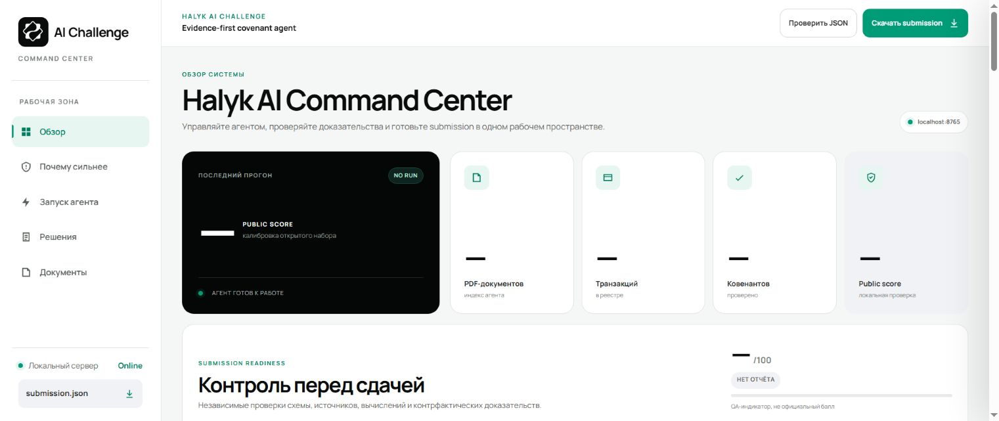
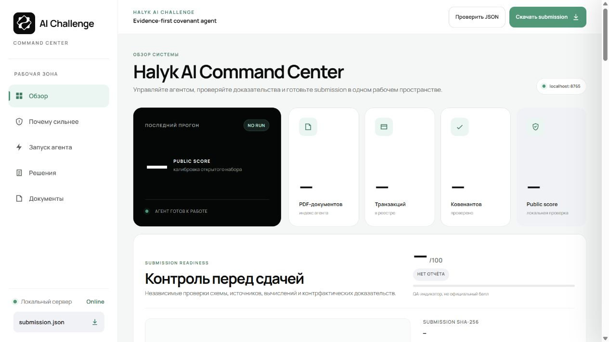
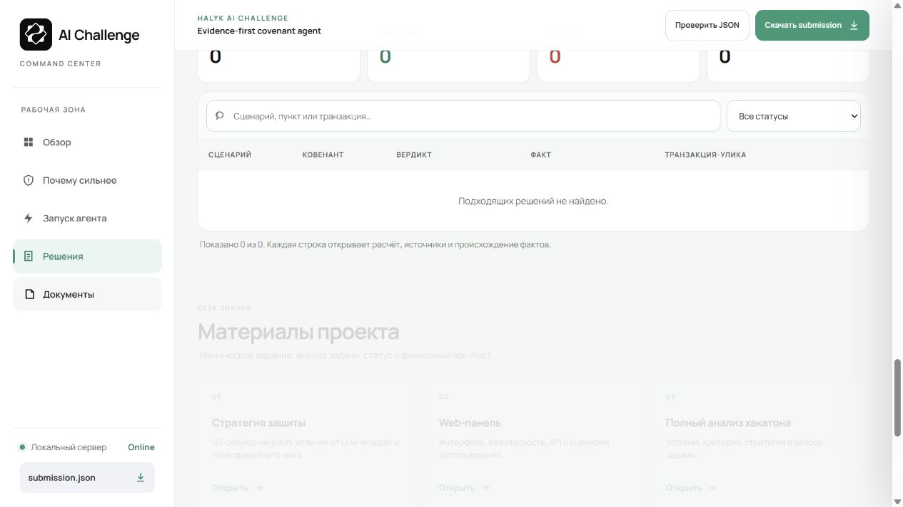

# Halyk Covenant Agent
### Every covenant verdict needs a path back to its evidence.

A document-analysis agent for the Halyk AI Challenge. It reads a document archive and transaction ledger, identifies applicable document versions, constructs a constrained calculation plan and produces a validated covenant result with a trace.



*The implemented local Command Center in its clean, no-run state. No customer documents or transaction data are included in this screenshot.*

**QwertyS · 26th of 160 ranked teams · official score 81.6688%**

[Official challenge](https://halykbank.kz/en/other/agentic-challenge) ·
[Official final leaderboard](https://halykbank.kz/storage/app/media/2026/8/leaderboard_final.xlsx) ·
[Public original code](https://github.com/pip00sya/Halyk-ai-agent) ·
[Result and source record](docs/portfolio/HACKATHON.md)

## Inspect the Command Center

[](docs/portfolio/media/halyk-interface-tour.mp4)

**[▶ Open the 30-second interface tour](docs/portfolio/media/halyk-interface-tour.mp4)** ·
[Technical workflow and artifact guide](docs/portfolio/TECHNICAL.md)

Recorded on **12 October 2026** from the initial public source: overview →
architecture → configuration → empty decision matrix → project documents.
No dataset was loaded, no agent/model run was started, and no benchmark result
was generated for the recording. It shows the implemented inspection surface.

<details><summary>Open the project's document workspace</summary>



</details>

## The archive is part of the problem

A covenant may depend on a final contract, an amendment, a waiver, an audit note and a particular set of transactions. Treating every extracted paragraph as equally authoritative can produce a numerically correct answer to the wrong version of the agreement.

The agent inventories PDFs with hashes and page-level text, classifies document roles and looks for applicable final versions. Pages with insufficient text can be routed through vision OCR in the model-backed mode. The resulting evidence needs both content and provenance before planning begins.

## Ask the model for a plan, not the final number

The planner returns structured output against the covenant schema: sources, relevant facts, a formula and candidate transaction evidence. An independent reviewer checks the plan against the original material. That creates a boundary at which unsupported document references, unknown transaction IDs and disallowed expressions can be rejected.

Arithmetic runs in a constrained deterministic layer using **Decimal**. The expression language supports a limited set of operations rather than executing arbitrary model-generated code. Rounding happens at the output boundary, so intermediate floating-point behaviour does not quietly alter a threshold comparison.

~~~mermaid
flowchart LR
 A[PDF archive and ledger] --> B[Inventory and version resolution]
 B --> C[Evidence extraction / OCR]
 C --> D[Structured semantic plan]
 D --> E[Independent review]
 E --> F[Reference and formula validation]
 F --> G[Decimal calculation]
 G --> H[Counterfactual evidence check]
 H --> I[Submission and decision trace]
~~~

## A transaction must matter to the verdict

Merely citing a transaction is not enough. The counterfactual check removes a candidate evidence transaction and examines whether the relevant verdict changes. This tests the claimed relationship between the cited transaction and the result instead of accepting a plausible-looking identifier.

Waivers and applicability exceptions are represented explicitly, keeping the measured actual value separate from a documented status override. A reviewer should be able to distinguish “the value is below the threshold” from “the threshold is not applicable under this exception.”

## The Command Center is an inspection surface


*The Command Center explains the document inventory, revision resolver, structured plan, Decimal engine and counterfactual evidence check.*

The local web panel organizes overview, run configuration, results and project documents. It can display preflight findings, a decision matrix, calculated values and the trace behind a selected result. A submission hash connects the displayed quality checks to a particular output file.


*Run configuration distinguishes Auto, Public and Private/LLM modes. The panel is idle, with no customer material loaded or model run started.*

| Check | What it prevents |
|---|---|
| Dataset preflight | Starting with missing required files or unusable inputs |
| Document and transaction references | Citing evidence that does not exist |
| Formula validation | Unsupported computation entering the calculation layer |
| Counterfactual check | Attaching a transaction that does not support the claimed verdict |
| Submission schema validation | Delivering the wrong keys, types or output structure |

**Implementation:** Python, PDF extraction / OCR, structured model output, independent review, Decimal calculations and a standard-library local web server. The browser receives provider-configuration status, not API keys.

## Results, with the right denominator

The documented **36/36 public calibration result** checks the known public material and calculation/output path. The public fact package is only enabled for an exact matching dataset fingerprint; it does not demonstrate model performance on unseen private documents. The separate competition result was **26th of 160 ranked teams**.

The screenshot shows the actual application shell without loading financial documents. The detailed walkthrough here explains the implemented evidence and calculation boundaries; it does not present an empty local dashboard as a newly completed benchmark run.


## The Halyk AI Challenge result

Halyk's challenge asked participants to reason across synthetic banking documents,
resolve revisions, connect facts to transactions, calculate indicators and justify
the final decision. Registration ran **31 July–5 August**; public data appeared
**6–8 August**, with the private dataset and submission deadline on **9 August 2026**.

The bank's linked final spreadsheet contains **160 ranked teams**. Its QwertyS row
records **rank 26**, **score_pct 81.6688**, and declared model
`codex-local-evidence-review`. The repository retains a small transcription of that
row with the download's checksum in [the result record](docs/portfolio/official-result.json).
The authoritative source remains the bank's spreadsheet.

### What can be reproduced and what was only archived

The full history/data copy retains both challenge datasets: **200 public PDFs and
302 private-stage PDFs**, together with outputs and traces. Its updated code passed
24 local tests and the Python 3.11/3.12 Windows/Linux CI matrix during migration.
The [Eye172 copy](https://github.com/Eye172/halyk-hackathon-1) is public at the
12 October 2026 review;
the [public original](https://github.com/pip00sya/Halyk-ai-agent) preserves the initial
source snapshot. They are explicitly different snapshots.

The **36/36 public calibration** described above is a known-data check, while the
**81.6688% official result** comes from the competition leaderboard. Neither an empty
Command Center capture nor an archived local quality report is presented as a new
private-dataset benchmark. An original competition video was not retained. The new, dated interface
tour above shows the inspection surface without a calculation run.

## Inspect the application and reproduce a run

Use Python 3.11 or later. The Command Center can be opened before loading data:

```sh
python -m pip install -r requirements.txt
python dashboard_server.py
```

Open `http://127.0.0.1:8765`. This repository includes the initial public agent
implementation, its dashboard, validators, public fact pack and tests.
The challenge PDF datasets and private-stage outputs are retained in the separate
[public full-history copy](https://github.com/Eye172/halyk-hackathon-1); they are
not part of this initial source checkout. “Private-stage” refers to the challenge
stage, not the current repository visibility.
Place an authorized copy of the public challenge dataset in `agentic-bank-public/`
before running:

```sh
python run_agent.py run --data agentic-bank-public --output submission.json --team QwertyS --contact-email YOUR_EMAIL
python run_agent.py validate --data agentic-bank-public --submission submission.json
python run_agent.py score --submission submission.json --ground-truth agentic-bank-public/ground_truth.json --details
```

The [development guide](DEVELOPMENT.md) retains the complete Russian instructions,
private-stage provider configuration, preflight, modes and artifact map.
[TECHNICAL_SPECIFICATION.md](TECHNICAL_SPECIFICATION.md) and [HALYK_AI_CHALLENGE_ANALYSIS.md](HALYK_AI_CHALLENGE_ANALYSIS.md) provide
additional technical context. Tests: `python -m unittest discover -s tests -v`.


---

### QwertyS

Jointly developed by **[Nurkhan Aimukatov / pip00sya](https://github.com/pip00sya)** and
**[Shakhnazar Akhmer / Eye172](https://github.com/Eye172)**.
Both are Full-stack, Software and AI Engineers; Shakhnazar also works in ML engineering.
Our shared experience includes product design, application development, AI integration,
testing and preparing working hackathon submissions. We contributed as equal engineering
partners across the project.


This public implementation and project presentation are maintained on Nurkhan's account.
[Full project on Shakhnazar’s account](https://github.com/Eye172/halyk-hackathon-1) ·
[Nurkhan's projects](https://github.com/pip00sya) · [Shakhnazar's projects](https://github.com/Eye172).

[Public initial source snapshot](https://github.com/pip00sya/Halyk-ai-agent) · [Full-history code/data copy](https://github.com/Eye172/halyk-hackathon-1) (public at the 12 October 2026 review).

[Hackathon record and supporting sources](docs/portfolio/HACKATHON.md) ·
[Media provenance](docs/portfolio/MEDIA.md).
